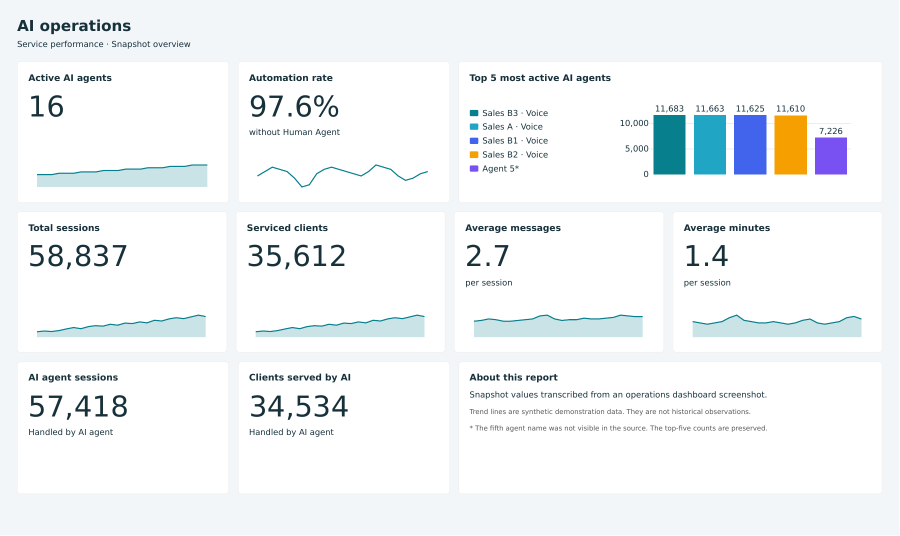
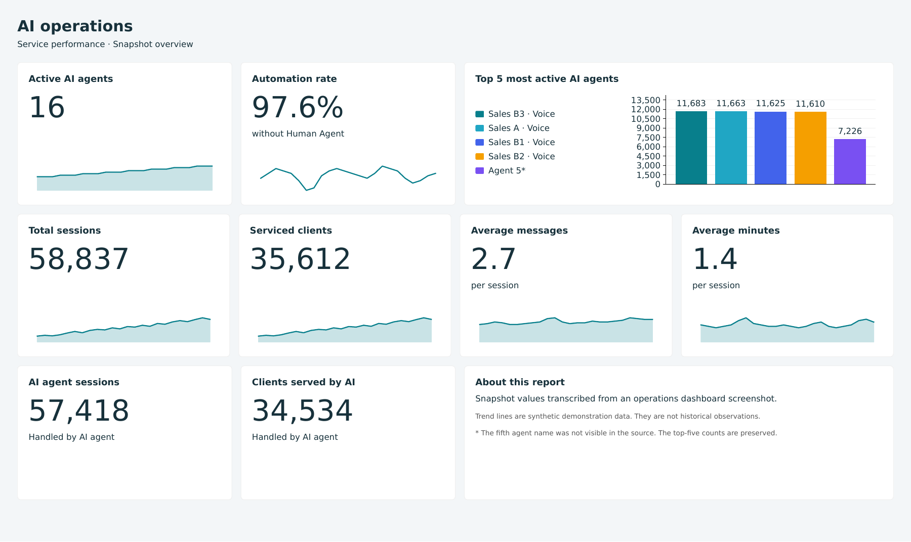
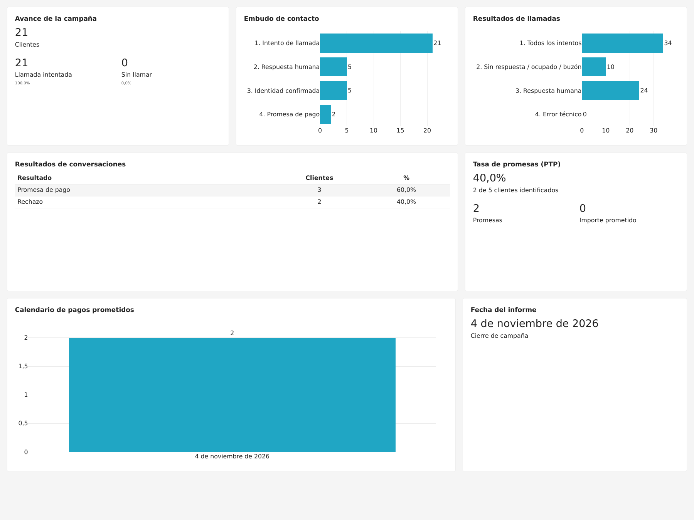
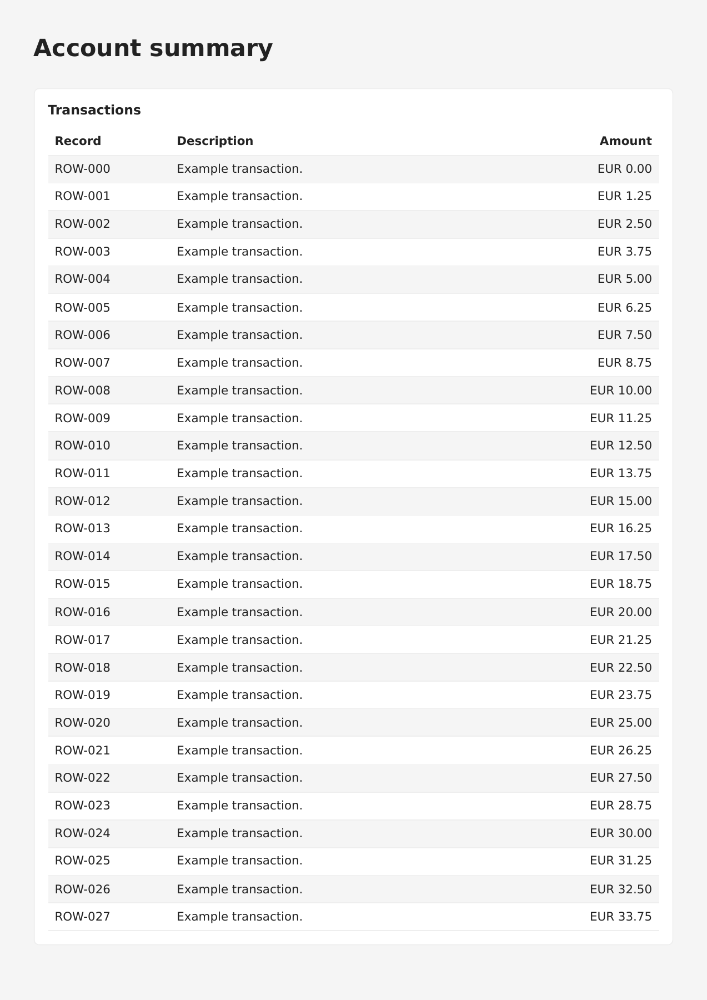
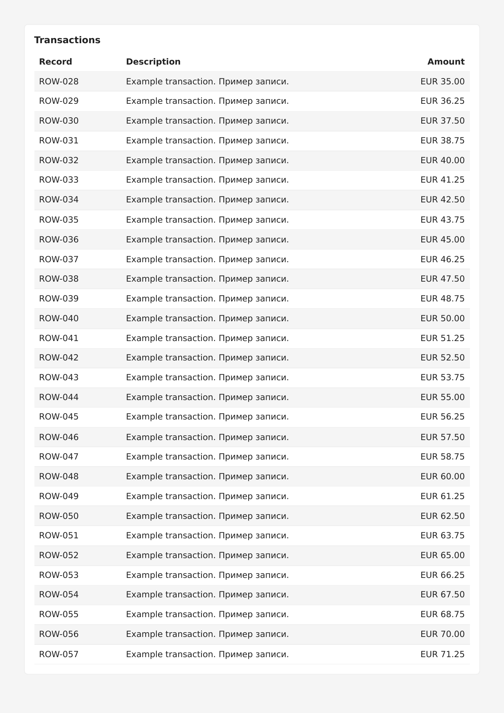

# CardReport

[](https://github.com/arch7tect/cardreport/releases/latest)
[](https://pypi.org/project/cardreport/)

[What’s new](https://github.com/arch7tect/cardreport/blob/main/CHANGELOG.md)

Build static reports in Python from cards, KPIs, charts and tables. Compose a
report, then get standalone HTML or PDF bytes for your application. PDF text is
selectable and charts are vector graphics.

Chromium is the default renderer. The experimental SVG/WeasyPrint renderer works
without JavaScript or a browser, with a smaller supported feature set. Both can
render grouped/stacked bars, multiple line series and funnels, including the
[series example](https://github.com/arch7tect/cardreport/blob/main/docs/user/examples.md#multiple-series-and-funnel). Both also render the [original reference example](https://github.com/arch7tect/cardreport/blob/main/docs/user/examples.md#reference-report).

## Reports in practice

These are images of PDFs produced by the library, not design mockups.

**Operations dashboard** — large KPIs, compact line charts and a color-coded
ranking. Snapshot values come from an operations dashboard screenshot; trends are explicitly
synthetic demonstration data. [Python, template and datasets](https://github.com/arch7tect/cardreport/blob/main/docs/user/dashboards.md).

The same template and datasets, rendered by both engines. Open either image for a full-size view.

| Chromium | SVG/WeasyPrint |
| --- | --- |
| [](https://github.com/arch7tect/cardreport/blob/main/docs/images/operations.png) | [](https://github.com/arch7tect/cardreport/blob/main/docs/images/operations-weasyprint.png) |

**Spanish campaign report** — the reference report with localized dates/numbers,
tables and charts. [Example and provenance](https://github.com/arch7tect/cardreport/blob/main/docs/user/examples.md#spanish-reference-report).



**Table across pages** — a 120-row demonstration report using `mode="flow"`.
Chromium moves complete rows to the next page and repeats the column headings
and card title. The first two pages show the continuation from `ROW-027` to
`ROW-028`. [Python example](https://github.com/arch7tect/cardreport/blob/main/examples/flow_report.py)
· [Embedding and pagination](https://github.com/arch7tect/cardreport/blob/main/docs/user/examples.md#long-table).

| Page 1 | Page 2 — continued |
| --- | --- |
| [](https://github.com/arch7tect/cardreport/blob/main/docs/images/flow-page-1.png) | [](https://github.com/arch7tect/cardreport/blob/main/docs/images/flow-page-2.png) |

## Install in your project

Python 3.12+ is required. Install from PyPI with uv, then install the PDF browser runtime:

```sh
uv add "cardreport[pdf]"
uv run python -m playwright install chromium
```

Keep your application’s uv.lock to pin the installed version. For HTML-only use, omit `[pdf]` and the
browser-install command. See [installation and quickstart](https://github.com/arch7tect/cardreport/blob/main/docs/user/quickstart.md)
for local checkouts, wheels and how to embed exports.

For browser-free PDF export, follow the [WeasyPrint setup](https://github.com/arch7tect/cardreport/blob/main/docs/user/renderers.md#weasyprint),
including native libraries and the library search path on macOS.

## Use from Python

### 1. Python components

```python
from cardreport import BarChart, Card, KPI, Report

report = Report("Call results")
report.add(Card(KPI("Total calls", 34)))
report.row(
    Card(BarChart(labels=["Answered", "No answer"], values=[24, 10])),
    height_mm=70,
)

html: str = report.to_html()
pdf: bytes = report.to_pdf()
```

### 2. JSON template and named datasets

The same report, with presentation and data kept separately. Both JSON documents
are inline in this [single Python file](https://github.com/arch7tect/cardreport/blob/main/examples/quickstart_template.py);
your application can also load them from files or a database.

```python
from cardreport import ReportTemplate, datasets_from_json

TEMPLATE_JSON = """
{
  "format": "cardreport.template/1",
  "datasets": {
    "summary": {
      "cardinality": "one",
      "fields": {"total": {"type": "integer"}}
    },
    "calls": {
      "cardinality": "many",
      "fields": {
        "result": {"type": "text"},
        "count": {"type": "integer"}
      }
    }
  },
  "report": {
    "title": "Call results",
    "blocks": [
      {"type": "card", "content": {
        "type": "kpi", "label": "Total calls",
        "value": {"bind": {"dataset": "summary", "field": "total"}}
      }},
      {"type": "row", "height_mm": 70, "children": [
        {"type": "card", "content": {
          "type": "bar", "dataset": "calls",
          "category": "result", "value": "count"
        }}
      ]}
    ]
  }
}
"""

DATA_JSON = """
{
  "format": "cardreport.data/1",
  "datasets": {
    "summary": {"columns": ["total"], "rows": [{"total": 34}]},
    "calls": {
      "columns": ["result", "count"],
      "rows": [
        {"result": "Answered", "count": 24},
        {"result": "No answer", "count": 10}
      ]
    }
  }
}
"""

template = ReportTemplate.from_json(TEMPLATE_JSON)
datasets = datasets_from_json(DATA_JSON)
report = template.bind(datasets)

html: str = report.to_html()
pdf: bytes = report.to_pdf()
```

The template declares the expected datasets and their fields; the data document
provides the values. `bind()` creates an ordinary `Report`, with the same export API
as the component-based example. See [templates](https://github.com/arch7tect/cardreport/blob/main/docs/user/templates.md)
and [datasets](https://github.com/arch7tect/cardreport/blob/main/docs/user/datasets.md) for other data sources and binding options.

Return `pdf` from your application, put it in storage, or use
`report.write_pdf("report.pdf")` to save a file. Existing files are preserved by
default. Reports reject content that does not fit rather than silently shrinking it.

## Use from the command line

Render JSON or YAML template/data files without a Python runner:

```sh
python -m cardreport render --template report.json --data data.json --output report.pdf
python -m cardreport render --template report.json --csv summary.csv --csv calls.csv --output report.html
```

Use `.yaml` or `.yml` for either input; JSON, YAML and CSV can be mixed.
`python -m cardreport validate` checks inputs without rendering.
CSV dataset names come from filenames; use `--csv-as NAME PATH` to rename one.
The installed `cardreport` command is equivalent. See the
[complete CLI example and options](https://github.com/arch7tect/cardreport/blob/main/docs/user/command-line.md).

## Documentation

- [Quickstart](https://github.com/arch7tect/cardreport/blob/main/docs/user/quickstart.md) — build from application data; return strings/bytes.
- [KPI dashboards](https://github.com/arch7tect/cardreport/blob/main/docs/user/dashboards.md) — compact charts, category legends and larger KPI values; [multi-page dashboards](https://github.com/arch7tect/cardreport/blob/main/docs/user/guide.md#dashboards-across-pages) use flow to carry whole rows and split tables.
- [Templates](https://github.com/arch7tect/cardreport/blob/main/docs/user/templates.md) — JSON presentation with separate named datasets.
- [YAML and JSON Schema](https://github.com/arch7tect/cardreport/blob/main/docs/user/yaml-and-schemas.md) — YAML embedding, schemas, data validation and editor setup.
- [Datasets](https://github.com/arch7tect/cardreport/blob/main/docs/user/datasets.md) — native Python data and typed JSON storage.
- [User guide](https://github.com/arch7tect/cardreport/blob/main/docs/user/guide.md) — cards, layout, formatting and multiple pages.
- [Language and display formats](https://github.com/arch7tect/cardreport/blob/main/docs/user/localization.md) — report language tags, custom dates, number precision and the Spanish example.
- [API reference](https://github.com/arch7tect/cardreport/blob/main/docs/user/api.md) — signatures, defaults, constraints and errors.
- [Renderers](https://github.com/arch7tect/cardreport/blob/main/docs/user/renderers.md) — installation, supported features and extensions.
- [Examples and integration](https://github.com/arch7tect/cardreport/blob/main/docs/user/examples.md) — the original report, tables and async code.
- [Command line](https://github.com/arch7tect/cardreport/blob/main/docs/user/command-line.md) — render JSON templates with JSON or CSV datasets using `python -m cardreport`.

For architecture, decisions and contributing, see [project documentation](https://github.com/arch7tect/cardreport/blob/main/docs/project/README.md).

## License

[MIT](https://github.com/arch7tect/cardreport/blob/main/LICENSE). Bundled DejaVu fonts retain their [font license](https://github.com/arch7tect/cardreport/blob/main/src/cardreport/assets/LICENSE_DEJAVU).
Third-party rendering packages retain their own licenses.
